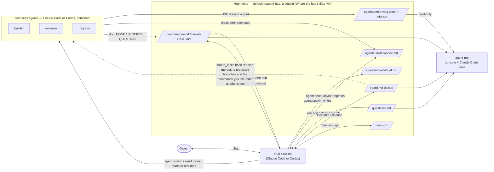
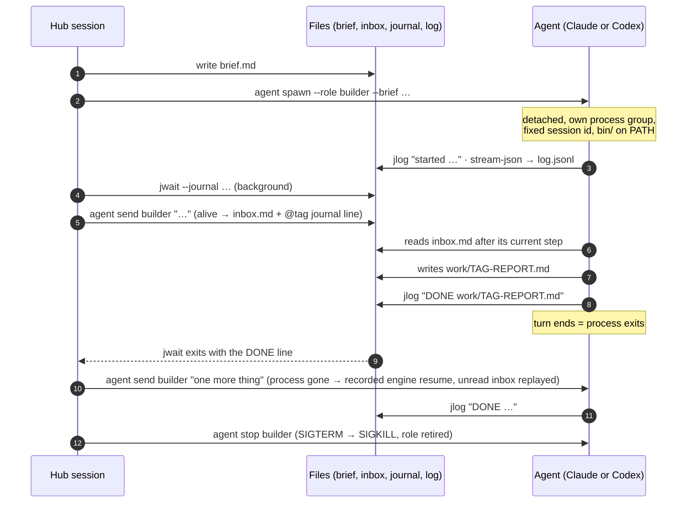
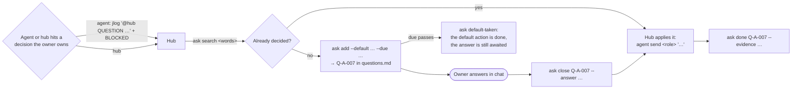

# Command and configuration reference

For a first stage, use [Getting started](getting-started.md). Agents: use the
[task router](agents/README.md) and load the hub skill for operating instructions.
Read only the section needed for the current task; each CLI’s `--help` owns its complete syntax.

**Names that keep `agent-hub`.** The product is Delamain, but some identifiers keep the name `agent-hub` they had before the rename
on purpose, so that existing stages, agents and configurations keep working: the `AGENT_HUB_*` environment variables,
the project directory `.agent-hub/` (`config.json`, `lock-rules.json`, `local/`), the default hub home
`~/agent-hub` (and the older `~/.claude/agent-hub`), the watchdog's `# agent-hub-watchdog` cron marker and its
`io.agent-hub.watchdog.*` launchd labels. Other pages mention them as they are.
For one release the plugin also bridges sessions started before the rename (code marked `rename:transition`):
it writes the markers `[agent-hub auto-handoff k/N]` and `[agent-hub watchdog]` as before the rename,
names its skills and agents in both forms in hook texts, points a prompt `/agent-hub:<skill>` (before the rename)
at `/delamain:<skill>`, and the agent-top mod answers `/agent-hub:agent-top` as before the rename. That code is
removed in the next release, once no session started before 1.0 remains; readers of the old forms stay longer.

## How it works

[Precise workflow sketch](assets/hub-workflow.svg) · [Delamain illustration prompts and reference](assets/illustration-prompts.md).



| Tool | What it does |
|---|---|
| `agent spawn / status / send / stop` | Start a detached Claude Code or Codex agent from a brief; check it; message it (inbox while alive, resume after exit); stop it. |
| `jlog` | Append `- HH:MM [tag] text` to today's stage journal. In another stage's journal the derived tag is stage-qualified (`[core-c-hub-30]`); the writer's `jwait --tag hub-30` on its own stage (core-c) also wakes on the answer `@core-c-hub-30`. |
| `tell` | Write to another stage's hub: one journal line `@hub …` (`--question`, `--role`) in that stage's journal, signed with your stage-qualified tag, and the registered direct address (session id, kind, title, the name for a cross-session message). `--address` prints the address only. A headless holder gets the text through `agent send` (it reads its inbox, not a journal). The answer comes back in your own journal (`tell <your stage>`). The journal is the preferred channel; a direct message goes only to this address. |
| `jwait` | The only waiter: block (in the background) until new journal or log lines match, or until an alarm time. With `--journal` it marks itself in `<hub home>/.jwait-state/<stage>/<caller>.armed.json` while it waits (pid, stage, tags, deadline), so the watchdog can tell a hub that waits from one that sleeps; it removes the file when it ends, also on SIGTERM and SIGHUP. |
| `await` | Run a wait command (the repo's CI wait script, a merge, a lock) detached from the caller and journal **one** line `@hub WORD LABEL — LINK (exit N, 12m, log PATH)` when it ends; nothing while it runs. Starts a supervisor in its own session and returns at once, so the hub makes it an ordinary foreground call and keeps its single `jwait`. WORD: exit 0 → `--ok` (default `DONE`, `MERGED` for a merge), 124 or the end of `--timeout` (default 2h) → `TIMEOUT`, anything else, a command that cannot start or a stopped supervisor → `FAILED`; `--on RC=WORD` maps more (`--on 3=CONFLICT`). LINK is `--link` or the last URL the command printed. Signed `<tag>-await`, which the hub's own `jwait` does not drop. [Waiting for CI](launch-modes.md#waiting-for-ci-a-merge-or-a-lock). |
| `roles` | Who plays which role, by full session id; cross-session send budget; broadcast. |
| `ask` | The owner-question register: questions with a default action and a due time, answers, decisions taken by agents. `ask inbox [--since T] [--stage S] [--json] [--if-quiet]` is the owner's digest across all stages: per stage what finished since the owner's last answer, which questions wait (overdue first), which decisions the hubs took, live and blocked agents; under 2 000 characters, read-only. |
| `lock` | The lock board for shared resources: `main-merge` is built in, every other resource is named by your project in `lock-rules.json`. `lock rules` shows, writes and tests those rules. |
| `hub start / takeover / handoff` | Register the first hub of a stage; hand a hub shift over in one command each. The shift number is derived. `hub handoff --finish` refuses a draft whose § 0–2 still hold `TODO` (`--allow-todo` overrides), `hub succeed` makes the same check, and `takeover` warns about such a handoff. Start and takeover run only in a fresh worktree of the project and move the session there otherwise (exit 4, `MOVE <path>`). `start` wants a stage name that says what the work is and a `--goal` line (see *Names*, below). `takeover` also records where the hub runs as `host:` in the stage's `hub` record of `roles.json` (`desktop`, `detached`, `bg` or `term`; left out for a Codex hub and when it cannot be told), and its digest prints the watchdog line: an active do-not-wake marker, and that the watchdog is on. |
| `hub rename` | `hub rename --stage OLD --to NEW [--dry-run]`: rename a stage none of whose agents is alive (otherwise exit 2, the live ones listed): its directory, the names and paths in its json files, the question register's heading and the board's lock notes that name it. |
| `hub close` | `hub close --stage S [--why TEXT] [--force] [--dry-run]`: close a stage whose hub is no longer needed. Refuses (exit 2) while an agent of the stage runs or an owner question waits (`--force` stops the agents and leaves the questions). Stops an idle background hub (a Desktop, terminal or busy one is named with how to end it), releases the locks held by the stage's sessions (not one whose holder plays a live role in another open stage, or may: a registry unread; such a hub session is not stopped either), retires every role, journals `close: …` and writes `"closed"` into `stage.json`. A closed stage is left out of agent-top (`--all` shows it), the watchdog, the night queue and the question summaries, and `agent spawn` refuses it; `hub start` / `hub takeover` reopens it and continues the hub numbering. |
| `hub grill` | `hub grill --stage S [--questions ID,…] [--also-stage S2] [--owner-words "…"] [--host auto|desktop|codex-app|bg|manual] [--again] [--dry-run]`: the owner asked to be grilled over the stage's open questions — run it in a separate interactive session, not in the hub's context. Writes a brief (`grill-<stamp>-brief.md`) over the stage's unresolved `Q-` entries (other stages only when the owner names them) and launches by host: Claude Desktop — prints `start_session` arguments with `initiation: "user_asked"` for the hub to call in the owner's turn (the `session_cards` hook lets it through); Codex app — `create_thread` arguments, the projectId taken from native `list_projects`; another Claude host — starts `claude --bg --remote-control <S>-grill` and prints its link; another Codex host — the command for the owner. After a native launch (or owner confirmation of the manual session id), the hub runs `hub grill bind --launch <id> --session <full returned id>`; bind and join may arrive in either order, but only matching identities activate the role (bg resolves its handle to the full sessionId itself). The session runs `hub grill join --launch <id>` (role `grill`, tag `grill`, one per stage; a launch replaced by `--again` or dropped cannot join), grills with the companion skill, records every answer with `ask`, and ends with `hub grill done --summary "…"`: one line `@hub GRILLED <a> answered, <w> withdrawn, <o> open of <n>; <k> new … — <summary>. Act on: ask list --pending --stage …` for every stage grilled over (`GRILLED` is a wake word of `jwait --hub-events`) and the role is retired. Only the registered session reports; the hub or the owner ends one that went away with `--why` (it says who ended it). A `claude --bg` start that gives no clear answer keeps the launch recorded, so a retry does not start a second session. Refused (exit 2) while a grilling session is registered or a launch has not joined within `AGENT_HUB_GRILL_JOIN_MIN` (30) minutes; exit 1 with nothing to grill. Every generated command pins the original absolute `AGENT_HUB_HOME`. Administrative registration requires `--why` and is journaled; cancelling pending also needs the matching `--launch`. Successful delegation, including confirmed activation after an uncertain bg launch, clears only the saved original hub grilling marker, preserving a newer grilling or successor; the interactive role has no automatic hub successor. No lock is taken. |
| `hub succeed` | Autopilot: start the successor of an automatic handoff — a background Remote Control session, else a headless hub, at the hub's own effort; `--replace` swaps the successor that already took over. |
| `hub grilling` | `hub grilling start / end / status`: mark that the hub is grilling the owner, so nothing hands it over automatically until the grilling ends ([No automatic handoff in the middle of a grilling](#no-automatic-handoff-in-the-middle-of-a-grilling)). |
| `hub effort` | The effort a Claude Code session runs at now and the source it was read from (hook input, `$CLAUDE_EFFORT`, transcript, a `--bg` session's `state.json`, the Desktop record, the process argv — most current first); `--session ID`, `--json`. Exit 1 when no source answers. |
| `agy-review` | The bundled Argon reviewer: `run --cwd <checkout> --brief <file>` starts a read-only review by Gemini 4 Argon through Antigravity CLI (`agy`), detached, in a run directory under `<hub home>/agy-runs/` that ends with an `rc` file (`0` = `final.md` is the review); `limits` reads agy's quota from its `/usage` panel; `check` is the availability test of a reviewer entry (agy installed, Argon's weekly quota not known to be below 20 %). The skill is `delamain:agy-review`. macOS only so far. [docs/reviewers.md](reviewers.md#the-bundled-argon-reviewer-agy-review). |
| `nightq` | Optional: a night queue with a permission matrix, for work that may continue while the owner sleeps; the watchdog wakes a silent hub for it. |
| `watchdog` | A job every 5 minutes (launchd or cron) that writes `EXIT` for dead agents and wakes a hub that sleeps while lines addressed to it wait. [Watchdog](#watchdog), [docs/monitoring.md](monitoring.md#watchdog-a-hub-that-sleeps-is-woken). |
| `agent-top` | Live console of all agents (curses), `--once` text, `--json`. It shows the stages of every known hub home, not only the resolved one ([the registry of homes](#where-the-hubs-files-live)). Summary lists the stages: an open one with no live agent and no activity for `AGENT_TOP_IDLE_S` (48 h) is marked idle, closed ones are hidden (`--all` shows them); `c` in the console and the `close` button in the pane (two presses) run `hub close`. |

More diagrams and the file formats: [docs/architecture.md](architecture.md).

## Minimal mode

You do not need all of it. One hub and a few agents need three tools: `agent` (spawn, status, send, stop), `jlog` and
`jwait`, plus `hub start` once per stage, which registers your session as `hub-1` and so gives `jlog` its journal tag.
`roles`, `ask`, `lock`, `hub takeover` and `hub handoff` matter once you have more than one interactive session, more
than one shift, or a shared resource; leave them until then. The night queue and the watchdog are optional; the send
budget is an optional module for macOS with Claude Desktop.

## Quickstart

`hub takeover` and `agent status` report the runtime version and `bin/` actually executing the command. A newer
cache for the host engine adds a warning; Claude uses `CLAUDE_CONFIG_DIR` or `~/.claude`, Codex uses `CODEX_HOME`
or `~/.codex`. The other engine's newer version is not an update warning for this host.


Start the first message of a session with `/delamain:hub`, for example `/delamain:hub I want CSV export on the
reports page …`. The slash command always loads the `hub` skill; a plain-language mention of it may be ignored by a
smaller model, which then plans and codes on its own. In Codex, ask to use `delamain:hub` explicitly; see [Codex setup](codex.md).
Or run the following Claude-worker example yourself (substitute your project and brief paths):

```bash
export HUB_STAGE=csv-export                   # one directory per stream of work under the hub home

# 1. once per stage: register this session as hub 1 (creates the stage directory, prints the first jwait)
hub start --stage csv-export --goal "Export the table as CSV" --session self

# 2. write a brief (template: templates/brief-executor-template.md) and start an agent in its own worktree
agent spawn --engine claude --role builder --cwd ~/code/webapp --model sonnet --worktree --brief ./brief-builder.md
#    its title (agent-top, the roles list) is "builder — <the brief's first heading> (stage-a)"; an effort or a model
#    above the default needs --reason "…" (AGENT_HUB_EFFORT_DEFAULTS, AGENT_HUB_REASON_*)

# 3. watch it
agent status builder                          # engine/model, alive?, last event, turns, last line, worktree
agent-top                                     # live console; agent-top --once for a text snapshot

# 4. message it — alive: into its inbox; finished: the session resumes with the message
agent send builder "after the tests pass, open the PR"

# 5. wait for its status line without polling (run in the background from Claude)
jwait --journal --tag hub-1 --tag hub --hub-events --for 50m

# 6. stop it
agent stop builder
```

`--worktree [BRANCH]` (default branch `agent/<role>`) runs the agent in an existing worktree of that branch, or in
`<repo>/.worktrees/<branch>` of the main repository, which `agent spawn` adds to `.git/info/exclude`. A branch that does
not exist yet starts from origin's default branch (after a bounded `git fetch`; the local ref, with a note, when the
fetch fails; the local main/master without an origin), not from the commit `--cwd` has checked out — `--base REF`
chooses another start (`--base HEAD`: the old behaviour). An existing worktree of the branch is reused so a re-spawn
continues the work: one under `<repo>/.worktrees/` as it is, one elsewhere (a Claude Code or Codex session's) only
when `git status` there is clean, with a note. With uncommitted changes there, or when `git status` fails,
`agent spawn` refuses before it creates or starts anything: commit there, or take another branch
(`--worktree <new-branch> --base <branch>`). Two agents writing
in one checkout overwrite each other, so give each agent that writes code its own. Nothing removes a worktree: once the
branch is merged, `git worktree remove <path>`.

**Names.** A stage called `hub-09` shows as "Hub hub-09 #1", signs `hub-09-hub-1` in other stages' journals and puts
"(hub-09)" on every agent title, and nothing says what it does. `hub start` therefore exits 2 for a stage name made only
of generic words (`hub`, `stage`, `wave`, `wp`, `task`, `work`, `test`, `tmp`, `new`, `default`, `stream`, `sprint`;
the hub-wide setting `AGENT_HUB_GENERIC_STAGE_WORDS` replaces the list), numbers and single letters (`hub-09`, `stage-2`,
`wave-a`, `wp3`) and asks for a name of 1–3 words about the goal (`retro-fixes`, `yc-move`). It also requires `--goal
"<one line: what the stage delivers, in the owner's words>"`, kept in `<stage>/stage.json`. The hub's registered title
becomes `Hub <stage> #N — <goal>` (the goal cut at 60 characters); `hub takeover`, `hub succeed`, the handoff draft, the
takeover digest and `agent-top`'s hub row carry the goal. A stage without a stored goal keeps the title `Hub <stage> #N`;
`takeover` never refuses on a name, and `takeover --goal "…"` sets or replaces the goal. The environment variable
`AGENT_HUB_NO_NAMING=1` skips both start checks silently, for scripted environments and the test suite (environment only).

**Where a hub runs.** `hub start` and `hub takeover` check their location before they register, journal or lock
anything. A hub works in a linked worktree of its project that has the project's `.agent-hub/` — not in the project's
main clone (it has whatever branch somebody checked out there, and no `.agent-hub/` at all on a feature branch that
predates it), and not outside git (a Claude Desktop session started under "No folder" runs in `~` or a temp dir). The
project is the repository of `--repo PATH`, else of the working directory, else the one recorded for the stage
(`<stage>/stage.json`, written by every successful start and takeover in a repository). A good place is refreshed: a
clean worktree with no commits of its own is fast-forwarded to origin's default branch. Any other place gets a worktree
`<repo>/.claude/worktrees/<stage>-hub-<n>` on a new branch from origin's default branch, and the command exits 4 with
`MOVE <path>`, how to move the session there (Claude Code: `EnterWorktree` with `path=<path>`, else
`mcp__ccd_directory__change_directory`; Codex: run later commands with that workdir) and the command line to re-run.
From a Desktop session under "No folder" the move goes through the project's main clone: `change_directory` to the
main clone (Desktop files a session in the sidebar under the folder it moved to — a worktree path gets a folder of its
own — and asks the owner to trust a folder it did not create, a prompt that expires in 5 minutes; the main clone is
usually trusted already), applied when the turn ends, so the hub starts no background command and ends that turn at
once; next turn it checks `pwd`, calls `EnterWorktree` with the worktree and re-runs the command.
With nothing that names a project it exits 4 with `NO PROJECT:`: re-run with `--repo <the project's main clone>`, or with
`--no-project` for a stage that has no repository (it starts in place and is recorded as such). The environment variable
`AGENT_HUB_NO_PROJECT=1` does the same silently, for scripted environments and the test suite (environment only: a cloned
repository cannot switch the rule off).

The brief template is short: why, decisions already made, steps with a check for "done", verification, where to stop and
a turn limit. `agent spawn` appends a footer that tells the agent how to talk back: `jlog "DONE <report path>"` when
finished, `jlog "@hub QUESTION …"` then `BLOCKED` when it needs an answer, and to read its inbox after every major step.
The footer names `jlog` as `"$HUB_BIN/jlog"`, and the agent starts with the plugin's `bin/` first on its `PATH` and in
`$HUB_BIN` (rebuilt at every spawn and resume, so a resumed agent follows a plugin update): an older `jlog` found first
would write to a journal the hub never reads. A `claude --bg` session gets the environment of the long-running Claude Code
daemon, with the `$HUB_BIN` of whichever plugin version the daemon started under; the SessionStart hook
(`hooks/path_shadow.py`) appends `export HUB_BIN=<this plugin's bin/>` to `$CLAUDE_ENV_FILE` when the variable is unset or
points elsewhere, and says so in one line when it replaced a stale value (nothing is written under Codex, which has no
such file, or on a machine without a hub home).
The longer `templates/brief-executor-advanced.md` adds production permissions, size limits and evidence rules;
`templates/brief-review.md` is the brief for a reviewer.

A full working day, step by step: [docs/a-day-with-delamain.md](a-day-with-delamain.md).

## Cost and turn limits

- **Limits are shared.** Your plan's usage limits are spent by your interactive session and by every headless agent
  together, and running several sessions at once multiplies token usage
  ([Claude Code docs](https://code.claude.com/docs/en/agents)).
- **Each turn re-reads the agent's whole context**, so cost grows faster than the number of turns, and a very long
  agent is the most expensive shape there is. [docs/why.md](why.md) lists measured examples from one project, such
  as an executor that ran 1,100 turns because it was never cut into pieces.
- **Give every brief a turn limit and a stop condition**, and cut day-long work into pieces: a fresh agent for each, with
  a short report or handoff file between them. The turn limit is a line in the brief; Delamain does not enforce it.
- **`agent-top` shows a dollar figure only when the CLI reports one** (a Claude agent's cost: the latest cumulative total
  of each of its sessions; a live run shows `—`). A hub is a Desktop or terminal session that logs tokens, not dollars, so
  its share of the stage's spend (`spend` in `agent-top --json`, a line in `--once`) is an estimate from its transcript,
  priced at what the stage's agents' own results show per model (±20 %); Codex agents show tokens only, never dollars.
- **Agents run on the latest models if Claude Code is current.** `--model opus|sonnet|haiku|fable` goes to the CLI,
  which resolves the alias to the newest model of that family: Claude Code 2.1.287 (the minimum supported version) and
  later gives `claude-sonnet-5-5`, `claude-opus-5-5` and `claude-fable-5-1`, an older CLI gives older models. `haiku`
  is `claude-haiku-5-5` only from Claude Code 2.1.296; 2.1.287 to 2.1.295 give `claude-haiku-4-5-20251001` (the minimum
  is not raised for it). Haiku 5.5 has an effort setting, so `--effort` and the effort defaults apply to it like to
  any other model; Haiku 4.5 accepts the flag and ignores it. Keep Claude Code updated; `agent spawn` and `hub start` warn when the CLI is older than 2.1.287,
  and without `CLAUDE_BIN` they start the
  newer of `claude` on `PATH` and the CLI bundled with Claude Desktop (`agent spawn` prints which). The plugin pins no
  ids, since a pin goes stale with the next release: the id each run reports is shown by `agent status`, the journal's
  `started headless agent` line, the roles note and `agent-top` (`sonnet-5-5`, not `sonnet`). The CLI's version is read
  with `claude --version` (5 s at most; the line `<version> (Claude Code)`) and remembered by path, size and modification
  time in `<hub home>/.state/cli-version/`. If you must hold a model, pin it with
  `AGENT_HUB_MODEL_MAP`.
- **A Claude agent loads no MCP server unless the task needs one.** An interactive session inherits the servers of
  your config, your enabled plugins and your claude.ai connectors; their tool names, instructions and "needs
  authentication" notes sit in every turn's context (about 3.5k tokens on one machine with a dozen servers, mostly
  unauthenticated, and about a second of startup). `agent spawn` starts the agent with no MCP server by default
  (`--strict-mcp-config`); `--mcp inherit` gives it the servers of your config, plugins and connectors (the behaviour
  before 1.0.11), `--mcp FILE[,FILE]` only the servers of those MCP config files (`{"mcpServers": {…}}`, the format of
  `claude --mcp-config`); `AGENT_HUB_SPAWN_MCP` sets the default. The choice is kept for the agent's resumes. `none`
  drops the servers of the project's own `.mcp.json` too: a repository whose agents need them sets `inherit` in its
  `.agent-hub/config.json`, which wins over a hub home's `none`. The hub chooses per task (browser checks, docs lookup,
  a GitLab or DB server need one). Codex has no switch for its plugins' servers: the flag is refused there (except
  `--mcp inherit`) and the setting does not apply.
- **Turns are counted per run.** `agent status` and `agent-top` show the last run's turns next to the total once an
  agent was resumed (`turns 31 (total 60)`; `31/60` in the agent-top list), so a limit in the brief can be checked.

### Limit pace

Before a launch, Delamain advises which engine, model class and effort to use for **this launch**
(`bin/limit_pace.py`). It compares fresh remaining weekly percentages; forecasts provide context, not a work
schedule. Nothing is queried online; it reads what the logs already hold:

- **Codex**: the `token_count` rate-limit events of the rollouts under `$CODEX_HOME/sessions` written in the last
  12 hours (the account bucket, `limit_id` `codex`), each with its own timestamp.
- **Claude**: the last `rate_limit_event` (`unifiedWindows.seven_day`, `five_hour`) of each headless agent's
  `log.jsonl` in the hub home written in the last 12 hours; the event has no time, so the log's modification time is
  the sample's. Interactive sessions do not log it: with no headless agent running, Claude's week is unknown or stale. Among samples within 10 minutes of the newest, the window instance with the latest
  reset stands, at its highest utilisation (inside an instance it only grows, and a log's mtime is not its event's time).

The display retains the elapsed share of each window, usage, recent burn over the last 6 hours of samples of the
same window (when they span at least an hour), the window's average rate and projected exhaustion. A window is
**on pace**, **ahead** (more than 10 points ahead of the elapsed share, or only recent burn projects exhaustion:
a burst), or **over pace** (every known rate projects exhaustion before reset). During the first 6 hours of a weekly
window the forecast is marked **low confidence**: it is display-only and alone never causes a move or refusal.
Five-hour windows are contextual only. Neither forecast supplies advice to delay, sequence or hold work until reset.
A sample older than 3 hours, or a window that reset since the latest sample, is **stale**. Unknown and stale data
never justify refusal or count as verified room on the other engine.

The advice follows one order, and a model or effort is never changed silently:

1. **Remove waste.** An effort above the task class's default for routine work (Sol high → medium, Sonnet xhigh →
   high). Keep the task class explicit when the work needs judgement.
2. **Compare remaining weekly percentages.** Below 20% remaining is the advisory threshold for being short.
   If the requested engine is short and the other has more fresh room, propose this launch there at an equivalent
   class: Opus/Fable ↔ Astra high (an executor that decides as it goes: Sol high), Sonnet high ↔ Sol medium,
   Haiku high ↔ Luna medium. Compare the percentages, even when the engine with more remaining has a worse pace forecast.
   If both are short, recommend the one with more room and warn that it may run out before reset.
3. **Preserve the owner's engine lock.** For `AGENT_HUB_STAGE_ENGINES`, a ready `ask add` asks whether to allow the
   other engine for **this launch**, with the equivalent model/effort and both weekly figures. The default is to run
   this launch on the locked engine. Permission for one launch leaves the stage's engine decision intact.
4. **State uncertainty.** If either weekly reading is unknown or stale, report the missing comparison and suggest
   a fresh probe. Continue under the requested engine choice; missing data does not create a gate.
   Below 3% remaining with an unverified alternative, explicitly warn of practical exhaustion and offer a probe
   or a launch with `--reason`, rather than giving an unconditional go recommendation.

The hard stop uses remaining quota, not projected pace:

| Fresh weekly readings | `agent spawn` in `on` mode |
|---|---|
| Requested engine has at least 3% remaining | Launch allowed, even if every forecast projects exhaustion before reset. |
| Requested engine has less than 3%, other engine has fresh verified data with at least 3% | Refuse the requested launch (exit 1, nothing created); propose the equivalent class on the other engine, or ask for this launch's engine permission when locked. |
| Both engines have fresh readings below 3% | Refuse and report both as practically exhausted. |
| Requested engine or alternative has unknown/stale data | No quota refusal based on the unverified comparison. |

The rules cover every task class. `--reason "…"` passes a quota refusal; the journal's start line records
`over the limit-pace stop (<numbers>) by --reason`. `AGENT_HUB_LIMIT_PACE=warn` keeps the advice and drops the
refusal; `off` drops both.

Where it shows:

```text
agent spawn … [--task-class mechanical|bounded|judgement] [--dry-run]
    the numbers and the advice for this launch; --task-class (default: by the model) sets the class the effort and
    the equivalent are judged by; --dry-run runs every check, prints the advice and starts or writes nothing
hub start / hub takeover     one line per engine in the digest
agent-top --once             "Limit pace" lines per engine; --json: limit_pace {engine: level, used, expected, eta, …}
watchdog (R6)                one `[pace] @hub LIMIT …` journal line per crossing in each stage with a hub
```

In the first 6 hours, low-confidence forecasts are displayed without a journal alarm, owner notification or
crossing-state record. At the confidence boundary, a crossing can be announced for the first time.
A later forecast crossing (on pace → ahead → over pace) is announced once per stage, engine, window and level; it is
context for the next launch's quota comparison, not a scheduling instruction. A level that falls
and rises again within the same window is not announced twice. The record is `<state dir>/limit-pace/crossings.json`.
`agent spawn` and the watchdog write it; the digest and `agent-top` only read.

```json
{ "AGENT_HUB_STAGE_ENGINES": { "dolya": { "engine": "codex", "decision": "Q-DL-054" } } }
```

## Agent lifecycle



When a run ends, a small wrapper checks the journal and writes one line under the agent's tag unless the agent wrote a
status word itself, so the hub's `jwait` wakes anyway. A run that ended normally (code 0, a successful result) with no
status word of its own is `ENDED <role>: …` — `REVIEWED <role>: …` for a review role, one whose name or tag has the word
`review`/`reviewer` in it (`review-pr34`, `desktop-review`) and which often cannot journal at all. Both are neutral: the agent
stopped, nothing looks wrong, and the hub reads the last text of the run with `agent status`. `EXIT <role>: …` is for
an abnormal end: a non-zero code, an error result, no result. `PROGRESS …` lines are not status words (the brief footer
tells agents to put milestones in the report or in such a line), so they neither wake the hub nor stand in for the
final status. When the process is killed together with the wrapper (`kill -9` of its group), the first
observer — `agent status` or the poll of `jwait --journal` (every 10 s) — journals `EXIT <role>: killed (no result)`
once per run (marker under `<state dir>/agent-exits/<stage>/`); `agent stop`, a registered role only, and a death
within the last day are the bounds. The brief and every message reach the CLI on stdin (`prompt-<run>.txt` in the agent's
directory), never in argv, so a `pkill -f "<words of a brief>"` cannot hit an agent.

An agent runs in its own session and process group (`setsid`), with its stdio in files and no controlling terminal: the
exit or kill of the session, terminal or app that spawned it — its process group, SIGHUP, the host alone — does not reach
it, for both engines (`tests/t_kill_guard.sh`). What still reaches it is a signal sent to its own pid: `agent stop`, or a
kill by name or pattern, which matches every process of the user. On 14.10 an agent's `pkill -f "[s]leep 300" -P 1`
killed Claude Desktop and four agents: macOS `pkill` reads options only before the first pattern, so `1` became a pattern.
The `kill_guard.py` hook refuses such commands (see [Agent discipline](#agent-discipline)).

Headless agent, foreground or background sub-agent of the hub, `claude --bg` or Desktop session — which to use when,
decided by what the work does and who must reach it rather than by how long it takes, with the measurements behind it:
[docs/launch-modes.md](launch-modes.md). `hub handoff` refuses while a sub-agent of the hub's session still runs.

Reviews are configurable: by default a reviewer is an ordinary `agent spawn`, and `hub reviewer --for <class>` chooses
among the reviewers you listed — your own reviewer skills included — and prints how to start it; `--second` adds an
optional second opinion from another vendor, at the hub's discretion: [docs/reviewers.md](reviewers.md).

## Owner questions



Every open question carries the action that happens if nobody answers by its due time, so work is never silently
stuck. A decision an agent takes on its own on a matter the owner normally decides is recorded with `ask decided` —
visible, contestable. The plan the owner approved is recorded with `ask plan` — after the owner's yes, not before (`agent spawn` warns while its stage has
none: show the plan to the owner first); `ask add|decided|plan --print-id` prints just the new id, for scripts. At session start a hook prints one line per stage — open, overdue, awaiting execution — in the
hub home, in repositories with `.agent-hub/` and for hub agents.

`ask inbox` is the one screen the owner reads after a break, instead of asking each hub in turn. It reads every stage of
the hub home and changes nothing. The window starts at the owner's latest recorded word (an answered question, a standing
permission, an approved plan, in any register), else 24 hours back (`--since 6h|2d|HH:MM|YYYY-MM-DD` sets it, at most 14
days). Per stage with news: finished work (journal lines that start with `DONE`, `MERGED` or `released`, counted, the
latest quoted), questions waiting for the owner with their default and due time (overdue first), decisions the hubs took
(`D-` ids), blocked and live agents. Stages with nothing new are one line at the end. The text is cut under 2 000
characters — the most urgent stages first, "K more: ask inbox --stage S" for the rest; `--json` is complete.
`--if-quiet` prints nothing while the owner's latest recorded word is newer than `AGENT_HUB_OWNER_DIGEST_AFTER` (`3h`),
so the hub skill's rule is mechanical. The owner's chat is not a register: an owner who talks to a hub without anything
being recorded still counts as silent after the threshold, and the hub shows the digest once per silence.

### Standing permissions

The owner's word that a class of action needs no question each time — "merge after green CI and a review", "deploy to
staging" — is recorded once and read by the hubs of every stage:

```bash
ask allow --stage web --class "merge, release" --words "«merge them, no need to ask»" --source "chat 06.10" \
    "merge a PR after green CI and one review; cut the release"     # → A-WEB-001, bound to the stage's repository
ask allow --list --stage web          # in force for web and its repository, recorded in any stage (--all: revoked too)
ask add --stage api --repo ~/src/webapp --class release "Release webapp?"   # exit 3: covered by A-WEB-001 (chat 06.10)
ask revoke A-WEB-001 --reason "…"
```

A permission is bound to the repository the action touches (`--scope repo`, the default: the stage's recorded
repository, or `--repo` — a path, a remote URL or an unambiguous short name; the repository is identified by its
normalized `origin` URL, else its main clone's path), to one stage (`--scope stage`) or to every repository (`--scope
all`); it lasts until revoked unless `--until` ends it. `ask add` refuses a question (exit 3, `covered by A-…
(<source>)` and the owner's words in full) only when every `--class` keyword, as written, is covered on every
`--repo` it names (default
the stage's repository); money, migrations and permissions/RBAC — named in the class or the text — are covered only by
a permission whose class names them (`AGENT_HUB_SENSITIVE_CLASSES`). Act under a permission only where the owner's
words cover the case (staging is not production); otherwise `--override "why"` adds the question and records why. A
partly covered question is added with what is not covered; a keyword found only in the text gives a warning. An
entry with no owner's words, an `until` other than `YYYY-MM-DD[THH:MM]`, scope `repo` without a `repo-id` or another
defect covers nothing and is shown as `INVALID` by
`ask allow --list`. The `hub start` / `hub takeover` digest lists the permissions in force for the stage after § 0
(what does not fit is `K more`), or says in one line that there are none. Record format, storage and matching rules: [Standing permissions](standing-permissions.md).
`skills/setup` proposes them after reading the project and the person; it ships no fixed list.

## Team use

- **One hub home belongs to one person on one machine.** The board, the journal and the registers are local files, so
  two people cannot share a hub home, and a lock held by one person's hub is invisible to another's.
- **`.agent-hub/` committed in a repository shares conventions, not agents or locks**: the lock resources and rules, the
  brief footer, the hub rules, the team's notes, the config defaults. Everyone who installs the plugin and opens the
  repository gets the same guard and the same briefs; each runs their own hub.
- **Where the hub keeps its files can be a convention too**: `"AGENT_HUB_HOME": "project"` committed in
  `.agent-hub/config.json` puts each person's hub files inside their own checkout (`.agent-hub/local/`, excluded from
  git). It is still local to that person and machine. A repository can choose only `"project"` or `"user"`, never a path
  (see [Where the hub's files live](#where-the-hubs-files-live)).

## File layout

```text
<hub home>/                           default ~/agent-hub (see Where the hub's files live)
├── board.md                          lock board (lock)
├── config.json                       optional: settings (see Configuration)
├── lock-rules.json                   optional: shared resources and the commands that touch them
├── hub-rules.md, HUB-NOTES.md        optional: your rules and notes for every hub (see Configuration layers)
├── .jwait-state/<caller>.json        what each jwait caller has already seen
├── .jwait-state/<stage>/<caller>.armed.json  a running journal jwait: pid, stage, tags, deadline (removed when it ends)
├── .state/                           context-budget warnings, delegation levels (agent discipline)
├── .state/watchdog/                  state.json, lock, log.md, run.sh (the job's shim), job.log (watchdog)
└── <stage>/                          one directory per stream of work
    ├── stage.json                    the stage's project (main clone) for the next hub, written by start/takeover;
    │                                 its goal; `closed` {at, why, by, hub} while `hub close` has it closed
    ├── roles.json                    role → full session id, kind, tag; send counts; `host:` of the hub (takeover)
    ├── do-not-wake.json              optional: watchdog quiet — who, when, until, reason
    ├── questions.md                  owner-question register (ask)
    ├── auto-handoff.json             autopilot: automatic handoffs in a row, the successor last started
    ├── grill.json                    `hub grill`: a grilling session launched that has not joined yet
    ├── night-queue.md, night-log.md  optional night queue (nightq)
    ├── handoff-facts.sh              optional: prints environment rows for hub handoff (also brief-footer.md, takeover.sh)
    ├── agents/<role>/                one headless agent
    │   ├── brief.md                  copy of the brief it was started with
    │   ├── inbox.md                  messages sent while it runs
    │   ├── log.jsonl                 stream-json of every run (spawn and resumes)
    │   ├── stderr.log
    │   └── meta.json                 session id, pid, model, effort, runs, unread messages
    └── coordinator/
        ├── HANDOFF-hub-<stage>-<date>.md
        └── work/
            ├── journal-YYYY-MM-DD.md one line per event: - HH:MM [tag] text
            ├── <tag>-REPORT.md       agents' reports
            └── hub-<n>-takeover-brief.md  autopilot: the brief of a headless successor

<repo>/.agent-hub/                    committed: the team's conventions, same file names as above (Configuration layers)
<repo>/.worktrees/<branch>/           agent worktrees from `agent spawn --worktree`, excluded in .git/info/exclude
<repo>/.claude/worktrees/<stage>-hub-<n>/  a hub's worktree from `hub start` / `hub takeover` (exit 4, MOVE), excluded too
```

## Where the hub's files live

The hub home (journals, inboxes, the question register, the lock board, handoffs) is resolved for the directory a tool
runs in, or for a hook the session's directory, in this order:

1. `AGENT_HUB_HOME` in the environment: any path. Set it in your shell, or for every Claude Code session with
   `{"env": {"AGENT_HUB_HOME": "…"}}` in your Claude Code settings.
2. A repository's `.agent-hub/config.json`, key `AGENT_HUB_HOME`: `"project"` or `"user"`, nothing else (any other value
   is ignored with a one-line warning: a cloned repository must not choose paths the tools write to). `"project"` is
   `<main checkout>/.agent-hub/local/`, shared by all worktrees of the repository and added once to `.git/info/exclude`;
   `"user"` is the user default.
3. The user default, `~/agent-hub`, a visible directory.
4. Legacy: while `~/agent-hub` does not exist and `~/.claude/agent-hub` (the default up to 0.6) does, the legacy one,
   with a warning at session start, in `hub start` and in `hub home`.

Two choices. **One shared home** (`~/agent-hub`, recommended): hubs of different projects can talk and share the lock
board and the locks. **Inside the project** (`"project"`): nothing outside the repository, and projects do not see each
other. `git clean -fdx` deletes the project home, journals and registers included.

Why not under `~/.claude`: Claude Code treats `.claude` as a protected directory
([permission modes § Protected paths](https://code.claude.com/docs/en/permission-modes.md)). A Write or Edit there is
prompted in `default` and `acceptEdits`, routed to the classifier in `auto`, denied in `dontAsk`, and `permissions.allow`
rules cannot pre-approve it; only `bypassPermissions` passes. The Bash sandbox
([§ Protected paths](https://code.claude.com/docs/en/sandboxing.md)) denies writes to most of `~/.claude` with no
`allowWrite` exemption, so under `/sandbox` `jlog`, `ask` and `hub` could not write there at all. A plain directory
granted with `--add-dir`, `/add-dir` or `permissions.additionalDirectories` is writable by the sandbox and needs no
prompt for edits in `acceptEdits`.

A session started outside the home needs that grant: `/add-dir <home>` (this session), `{"permissions":
{"additionalDirectories": ["<home>"]}}` in `~/.claude/settings.json` (every session), or `claude --add-dir <home>`.
Children need nothing: `agent spawn`, a resume (`agent send` to a finished agent), the autopilot successor and the
headless successor get `AGENT_HUB_HOME=<the parent's home>`, so parent and children never resolve differently, and
`--add-dir <home>` when the home is not under their directory. A stage that is not in the resolved home but exists in
`~/agent-hub` or the legacy home is refused with an error naming where it is: migrate the legacy home (or `mv` that one
stage when the home is another one), set `AGENT_HUB_HOME` to that place, or `mkdir -p <home>/<stage>` to start afresh.

**The registry of homes.** A project home lives inside an arbitrary repository, so nothing can find it by scanning. The
tools therefore record every home a stage is registered in (`roles set`, `hub start`, `hub takeover`, `agent spawn`) in
one file outside every home: `${XDG_CONFIG_HOME:-~/.config}/delamain/homes.json`, entries `{path, layer, repo,
first_seen, last_seen}` (`repo` is the main checkout of a project home). It is written atomically under a lock, at
most once a day per home when nothing else changed, and an entry whose directory is gone is dropped on the next write. It
is a convenience: a registry that cannot be read or written never fails a tool (a hook says nothing, another tool at most
one stderr line), and the home a tool resolves is chosen as above, never from the registry. `agent-top` shows the stages
of every *known* home: the resolved one, `~/agent-hub`, the legacy one while it exists, `$AGENT_HUB_HOME` and the
registered ones that still exist (`known_homes()` in `bin/hubcore.py`). While stages come from more than one home, a
stage outside `~/agent-hub` is named `stage · <repo>` (the repository's directory name for a project home, else the
`~`-path), in the console, `--once`, `--widget` and the pane; with one home nothing changes. That name is for display
(and the key within one snapshot): the identity of a stage is its home and own name, and every action of the console and
the pane (stop, send, close, a card) is bound to that pair when it is armed, so another home gaining a stage of the same
name never redirects it. In `--json` the same name is the stage's `stage`, `stage_info[<id>]` gains `name`, `home` and
`home_label`, every agent `stage_name`, `home` and `home_label`, and the top level `homes` (path, label, layer, repo, stages)
and `multi_home`. `--stage` (and `/agent-top --stage`) takes `NAME` (that stage in every home that has it), `NAME@LABEL` or
`NAME@/path/of/home` (one home's; `NAME@` is the `~/agent-hub` one) — a selector with no spaces — and the displayed `name · label`. The name ends at the first `@` or ` · `, so a label or a path
may hold `@`, spaces or `·`; in `/agent-top` quote a selector with spaces (`--stage "alpha@my repo"`, or `my\ repo`). The pane
compares a path selector after normalising it (`//`, `.`, `..`, trailing `/`); the CLI also resolves symlinks. The Locks
section shows the boards of every home whose stages are shown, a lock of another home with its label.
The plan-limit advice reads the logs of every known home, and, for one stage in view, that stage's settings in its home.
A registration never replaces a more specific provenance by a less specific one (a child tool pins `AGENT_HUB_HOME`, so it
sees a project home as `env`): the entry keeps `project` and its repository. `tell`, `agent`, `hub` and the other tools still address the resolved
home only: a "no such stage" error adds *stage S exists in home <path>; run from that project or set
`AGENT_HUB_HOME=<path>`* when a known home has it. A stage of another project's home is not a conflict: a stage of the same
name can be created in this one. The refusal above for `~/agent-hub` and the legacy home is unchanged.

```bash
hub effort [--session ID] [--json]   # the effort this (or that) Claude Code session runs at now, and where it was read
hub home [--cwd DIR] [--json]   # the home, the layer that chose it, protected or not, the grant lines with your path
hub home migrate                # dry run: what would move from the legacy home to the resolved one
hub home migrate --apply        # do it; --from DIR / --to DIR name other homes
```

`migrate --apply` refuses while any agent of any stage of the source is alive or a background hub (an autopilot
successor) of one of its stages runs, and when a source path already exists in the target. It copies into a staging
directory beside the target (modes kept), verifies the count and the bytes, moves the copy into place only then (a
failed copy leaves nothing at the target), rewrites the old absolute path in every `*.json`
under the new home (roles, agents' meta, `.jwait-state`, `.state`, autopilot state), leaves the `.md` history as written
and renames the source to `<source>.migrated-YYYYMMDD`. It never deletes; a second run says there is nothing to migrate.
Run it while no hub session of the source is working: it cannot see an interactive session, and a line such a
session writes during the copy stays behind in the renamed source.

## Configuration

Settings are environment variables; each can also be set in a `config.json` (below), the environment winning.

| Variable | Default | Meaning |
|---|---|---|
| `AGENT_HUB_HOME` | `~/agent-hub` | The hub home above. The environment (any path), or a repository's `.agent-hub/config.json` with `"project"` or `"user"` only; the hub home's `config.json` cannot set it. [Where the hub's files live](#where-the-hubs-files-live). |
| `HUB_STAGE` | `default` | Stage when `--stage` is not given (environment only). |
| `HUB_TAG` | from `roles` | Journal tag of the caller (set for agents automatically; environment only). Without it the tag is the registry entry of this session's id; for a Claude Desktop session whose CLI restarted (a new `$CLAUDE_CODE_SESSION_ID` under the same `local_…` id) it is found through `$CLAUDE_CODE_HOST_SESSION_ID`, provided Desktop's own record of that session names this CLI session, and the registry's CLI id is refreshed. |
| `AGENT_HUB_TZ` | local zone | IANA time zone of journal times and deadlines. Hub-wide. |
| `AGENT_HUB_MODEL_MAP` | none | Opt-in pin of aliases to model ids (without it an alias follows the CLI, which resolves it to its latest model), e.g. `sonnet=claude-sonnet-…,opus=claude-opus-…` (in JSON also `{"sonnet": "…"}`). A model id may use letters, digits and `. _ : @ [ ] / -` only (a Bedrock id or an ARN is fine); a pair outside that is reported and left out. |
| `AGENT_HUB_DEFAULT_EFFORT` | `high` | Effort for `agent spawn` without `--effort` and without an `AGENT_HUB_EFFORT_DEFAULTS` entry for the model, for every model including `haiku`. |
| `AGENT_HUB_EFFORT_DEFAULTS` | none | JSON object `{"<model>": "<effort>", …}`: the effort of `agent spawn` without `--effort`, per model, for both engines (Codex by its own names and efforts). A key is a glob or a plain word matched anywhere in the model name; the alias given and the id it maps to are both tried, the first matching key wins. A repository may set it. It is also the yardstick of `--reason`: an effort ranked above it needs one. |
| `AGENT_HUB_REASON_MODELS` | none | Hub-wide. JSON list of models (globs or plain words) that count as above the default: `agent spawn` of one needs `--reason "…"`. A Codex spawn without `--model` and without `AGENT_HUB_CODEX_DEFAULT_MODEL` has an unknown model (the plugin does not reproduce the Codex CLI's config layers): with this list set, policy `refuse` refuses it ("the model the Codex CLI will choose cannot be checked: pass --model", a `--reason` does not help) and `warn` prints one warning that the model check was skipped; with the list empty (the default) nothing changes. The per-model effort default of an unknown model is the general one. `hub succeed` passes a reason of its own, so a refusing policy never stops the autopilot chain. |
| `AGENT_HUB_REASON_POLICY` | `warn` | Hub-wide. What an `agent spawn` above the default (an effort above the model's default, or a model of `AGENT_HUB_REASON_MODELS`) gets when it has no `--reason`: `warn` (one stderr line, the agent starts), `refuse` (usage error, nothing starts), `off`. The reason goes into the journal's start line and the agent's `meta.json`. |
| `AGENT_HUB_RESUME_MAX_CTX` | `250k` | Hub-wide. Tokens of context (`250000`, `250k`, `1m`; `0` = no limit) above which `agent send` refuses to resume a stopped agent: every turn of a resume re-reads the whole context, and a fresh agent from a handoff file costs less. The refusal says so and queues nothing; `agent send <role> --resume-anyway "…"` overrides it. The size is the last main-thread model call's input as `agent status` shows it (`ctx 300k`); a log without one (Codex's `exec --json` carries no per-call input) is not refused. |
| `AGENT_HUB_ENGINE` | `claude` | Default executor engine (`claude` or `codex`); Codex SessionStart selects `codex` for that host. |
| `CODEX_BIN` | `codex` on PATH | Codex executable for detached workers. |
| `AGENT_HUB_CODEX_DEFAULT_MODEL` | CLI configured model | Optional Codex model pin when spawn omits `--model`. |
| `AGENT_HUB_CODEX_MODEL_MAP` | none | Explicit Codex model aliases; Claude aliases are not translated automatically. |
| `AGENT_HUB_CODEX_HOOK_TRUST` | `bypass` | Detached Codex hook trust policy: bypass runs all enabled hooks without persisted review; `reviewed` requires Codex trust. |
| `AGENT_HUB_SPAWN_MCP` | `none` | MCP servers of a Claude agent without `agent spawn --mcp`: `none` (the default: no server, `--strict-mcp-config`), `inherit` (your config, enabled plugins and claude.ai connectors; the behaviour before 1.0.10), or absolute paths of MCP config files, comma-separated (only their servers: `--strict-mcp-config --mcp-config …`). A repository may set `inherit` or `none` only (in its `.agent-hub/config.json`, or in a hub home inside it: `AGENT_HUB_HOME` `project`) — a file's servers are commands the CLI would start without the approval a project's `.mcp.json` needs. `none` and files drop the project's own `.mcp.json` servers too; a repository that needs them sets `inherit` in its `.agent-hub/config.json`, which wins over a hub home's `none`. A resume keeps the spawn's choice; a headless autopilot successor always inherits; Codex agents ignore it. |
| `AGENT_HUB_PERMISSION_MODE` | `bypassPermissions` | Permission mode of headless agents (nobody is there to approve a prompt). |
| `AGENT_HUB_DEFAULT_REPO` | the git repository you run in (a worktree: its main repository), else `*` | Repository of `lock take/release` and of the main-merge lock `hub takeover --take-main-merge` takes; `*` (every repository) only outside a git checkout or with an explicit `--repo '*'`. The name is the checkout directory's; when it differs from the remote's (`gh … -R owner/name` is matched by the name it gives), set the variable or pass `--repo`. `lock rules init` writes it into `.agent-hub/config.json`. |
| `AGENT_HUB_TAKE_MAIN_MERGE` | `false` | `true` (string or JSON boolean): `hub start` and `hub takeover` take the hub repository's main-merge when it is free (absent or expired), and `hub takeover` also when an earlier hub of the same stage holds it, as if `--take-main-merge` were given. A lock held by anyone else (another stage's hub, a steward) is left alone with the hint to use `--take-main-merge`, whatever this says; so is any held lock on `hub start`. The explicit flag takes it from anyone and prints an `ATTENTION` line with the holder's stage and the age of its latest journal line. Without the setting, a free main-merge of a configured hub repository is reported in the digest. |
| `CLAUDE_BIN` | the newer of `claude` on PATH and the CLI bundled with Claude Desktop | The CLI to run agents with: a path, a name on PATH, or `desktop` — the newest CLI bundled with Claude Desktop (macOS), which follows Desktop updates. |
| `AGENT_INIT_TIMEOUT` | `120` | Seconds to wait for a new run's init event before calling the spawn failed. |
| `AGENT_HUB_REVIEWERS` | one `agent` entry | Ordered JSON list of reviewers, first available wins (`hub reviewer`); entries are agents or reviewer skills, with an optional `check` command, `until` date, change classes and `second` flag (an entry only for `hub reviewer --second`). A `check` is never run from a repository's config. [docs/reviewers.md](reviewers.md). |
| `AGENT_HUB_REVIEW_MODEL`, `AGENT_HUB_REVIEW_EFFORT` | `opus`, `high` | Model and effort of an `agent` reviewer that names none. Pick a model other than your executors' (the reviewer is not the author). |
| `AGENT_HUB_AGY_BIN` | `agy` on PATH | The Antigravity CLI that `agy-review` runs. Hub-wide: the environment or the hub home's `config.json`, never a repository's. |
| `AGENT_HUB_AGY_REVIEW_MODEL` | `gemini-4-argon-high` | Model id of an `agy-review run` without `--model`. Hub-wide. |
| `AGENT_HUB_AGY_REVIEW_MIN_LEFT` | `20` | Percent of Argon's weekly quota below which `agy-review run` refuses (exit 3) and `agy-review check` fails; an unreadable quota never does. Hub-wide. |
| `AGENT_HUB_BG_WAIT_CEILING_MS` | `0` | How long an agent's run, after its turn ends, waits for its background sub-agents before the CLI kills them (passed as `CLAUDE_CODE_PRINT_BG_WAIT_CEILING_MS`; `0` = until they finish, the CLI's own default is 10 min). |
| `AGENT_HUB_SEND_CAP` | `10` | Cross-session sends per sender before `roles` falls back to the journal (Claude Desktop only). Hub-wide. |
| `AGENT_HUB_NIGHT` | `23:00-08:00` | Night window for the optional `nightq`; the watchdog wakes a silent hub for open night-queue items inside it. Hub-wide. |
| `AGENT_HUB_WATCHDOG` | off | The watchdog acts only when on (`true`/`on`); `watchdog install` sets it on, `uninstall` off, and an installed job with it off exits 0. Hub-wide. |
| `AGENT_HUB_WATCHDOG_EVERY` | `5m` | Interval of the job (1 min to 24 h; cron: 1-59 min or whole hours). Read by `install`: change it, then run `install` again. Hub-wide. |
| `AGENT_HUB_WATCHDOG_WAKE_AFTER` | `15m` | How long lines wait, the hub is silent, or an API-error turn lies before a wake; the first step of the backoff. Hub-wide. |
| `AGENT_HUB_WATCHDOG_BACKOFF_MAX` | `4h` | Cap of the wake and notification backoff (15, 30, 60, 120, 240 min). Hub-wide. |
| `AGENT_HUB_WATCHDOG_NIGHT_QUEUE` | `on` | Open night-queue items inside `AGENT_HUB_NIGHT` count as waiting work. Hub-wide. |
| `AGENT_HUB_WATCHDOG_API_ERROR` | `on` | R4: wake on a Claude API error or a confirmed idle Codex app's final matching `server_overloaded` turn. [Evidence boundary](monitoring.md#which-host-is-woken-how). Hub-wide. |
| `AGENT_HUB_WATCHDOG_REAP` | `on` | R7: stop (never remove) the idle background session of a hub that is retired in this home's open stages and live nowhere on the machine (no live role or pending successor in any known home), after it has been quiet for `AGENT_HUB_WATCHDOG_WAKE_AFTER` (at least 15 min); a busy, blocked or child-holding one is reported once a day, not stopped. Per home: `off` also protects the hubs retired in that home from the watchdog of another. [Details](monitoring.md#retired-hubs-are-stopped-r7). Hub-wide. |
| `AGENT_HUB_NOTIFY_LOCAL` | `on` | Local notification of the watchdog (`osascript` on macOS, `notify-send` elsewhere when present). Hub-wide. |
| `AGENT_HUB_NOTIFY_CMD` | none | Remote notification: a JSON list of strings, run without a shell, `{message}` replaced by the text (stage name, minutes, counts, event word only), e.g. `["curl","-fsS","-d","{message}","https://ntfy.sh/<topic>"]`. Empty = no remote channel. Hub-wide. |
| `AGENT_HUB_SPAWN_HOLD_LOAD` | none (off) | R5: the 1-minute load average per core above which the watchdog holds spawns (`1.5`, `0.75`); the hold ends below 80 % of it. Empty or invalid (warned) = off. Hub-wide. |
| `AGENT_HUB_SPAWN_HOLD` | `warn` | What `agent spawn` does while a load hold is on: `warn` (a warning, the spawn goes on) or `refuse` (exit 1); `--ignore-hold` passes either. Invalid (warned) = `warn`. Resumes (`agent send`) are never held. Hub-wide. |
| `AGENT_HUB_LIMIT_PACE` | `on` | [Limit pace](#limit-pace): `on` (advice, and the one hard stop of `agent spawn`), `warn` (advice only), `off` (neither, and no watchdog R6). Hub-wide. |
| `AGENT_HUB_STAGE_ENGINES` | none | The owner's engine decision per stage, a JSON object: `{"<stage>": "codex"}` or `{"<stage>": {"engine": "codex", "decision": "Q-…"}}`. Limit-pace proposes an `ask add` for permission to use the other engine for this launch; the default runs the locked engine. Hub-wide: a repository cannot unlock a stage. |
| `AGENT_HUB_HANDOFF_MAX_BYTES` | `15360` | Size cap of `HANDOFF-*.md` enforced by the hook. Hub-wide. |
| `AGENT_HUB_SCOPE_DIRS` | none | Directories, separated by `:`, where the `handoff_size` and `questions` hooks act in addition to the hub home and repositories with `.agent-hub/`. Hub-wide: a repository's `config.json` cannot set it. |
| `AGENT_HUB_JWAIT_MATCH` | none | Extra wake words, a regex added to the built-in `MERGED\|STOP\|DONE\|BLOCKED\|EXIT\|QUESTION\|ENDED\|REVIEWED\|GRILLED\|AWAITING ANSWER`: used by the digest's `jwait` command and counted as an agent's status word. Hub-wide. |
| `AGENT_HUB_GENERIC_STAGE_WORDS` | `hub, stage, wave, wp, task, work, test, tmp, new, default, stream, sprint` | Words that name no work: `hub start` and `hub rename` refuse a stage name made only of these, numbers and single letters. A comma- or space-separated list that replaces the default one. Hub-wide. |
| `AGENT_HUB_GRILL_JOIN_MIN` | `30` | Minutes a `hub grill` launch that has not run `hub grill join` blocks another launch of the stage (a Desktop start or a Codex thread may still come up); after that, or with `--again`, a new launch replaces it. `AGENT_HUB_GRILL_LINK_WAIT_S` (90) bounds how long `hub grill` waits for a background session's Remote Control link. |
| `AGENT_HUB_JWAIT_FOR` | `50m` | How long one `jwait` waits when it is given neither `--for` nor `--until`, and the `--for` of the digest's `jwait` command: a duration such as `50m` or `1h30m`, at most `24h` (anything longer, zero or unparsable warns and falls back to `50m`). The default stays inside the one-hour prompt cache and ends before the ~54 minutes after which Claude Code 2.1.299+ compacts an idle conversation, so a hub's wake does not re-write its whole context into it; the Bash `timeout` of a background wait stays at or above it. Hub-wide. |
| `AGENT_HUB_OWNER_DIGEST_AFTER` | `3h` | Owner's silence after which the hub opens its reply with `ask inbox`: `ask inbox --if-quiet` prints nothing while the owner's latest recorded answer (an answered question, a standing permission, an approved plan, in any stage's register) is newer than this, and the digest otherwise. A duration such as `90m` or `6h`, at most `30d`; anything else warns and falls back to `3h`. Hub-wide. |
| `AGENT_HUB_SENSITIVE_CLASSES` | money, migration, permissions | Classes of action a standing permission covers only when its own class names them: a JSON object `{"class": ["stem", …]}`; a stem in a question's text or class makes the class a requirement ([Standing permissions](standing-permissions.md)). Hub-wide. |
| `AGENT_BOARD_FILE`, `AGENT_HUB_LOCK_RULES` | in the hub home | Override the board and the hub home's lock-rules file (environment only; a named lock-rules file must exist). |

### Configuration layers

A team keeps its conventions in its repository instead of forking the plugin. The tools read the same file names
from three places, most specific first (`delamain:setup` writes the first two files of the project layer for you):

| Layer | Where | Found by |
|---|---|---|
| stage | `<hub home>/<stage>/` | the command's stage |
| project | `<repo>/.agent-hub/` | the working directory, searched upwards to the git root (a linked worktree without its own `.agent-hub/` uses the main checkout's); for `agent spawn`, its `--cwd`; for the lock hook, the command's directory after `cd` / `git -C` |
| home | `<hub home>/` | always |

| File | Layers | Combination | Used by |
|---|---|---|---|
| `config.json` | project, home | per key, project first; hub-wide keys only from home | every tool |
| `lock-rules.json` | project, home | rules of both, project first; protected branches united | `board_locks` hook |
| `brief-footer.md` | stage, project, home | first found | `agent spawn`: appended after the standard footer; `{role}` `{tag}` `{stage}` `{report}` `{inbox}` are filled in |
| `handoff-facts.sh` | stage, project, home | first found | `hub handoff`: prints rows `\| What \| State \| Where it shows \|` for § 1 |
| `takeover.sh` | stage, project, home | first found | `hub takeover`: an extra verified step (below) |
| `hub-rules.md` | stage, project, home | all of them; a later layer wins on the same subject (home, then project, then stage) | the hub: overrides of the `hub` skill's recommended rules, each with its reason (example: [templates/hub-rules-example.md](../templates/hub-rules-example.md)); the takeover digest points at it |
| `HUB-NOTES.md` | stage, project, home | first found | the hub: what the team knows (what needs the owner, how to check data claims, …); the takeover digest points at it and the `hub` skill reads it before planning |

`config.json` is a flat JSON object of the settings above; keys starting with `_` are comments. A key a layer may not
set (a hub-wide key in a repository, a misspelling) and a broken file are reported on stderr and ignored, so a typo
never stops a tool:

```json
{"_comment": "webapp hub conventions",
 "AGENT_HUB_MODEL_MAP": {"sonnet": "claude-sonnet-x-y"},
 "AGENT_HUB_DEFAULT_EFFORT": "high",
 "AGENT_HUB_DEFAULT_REPO": "webapp"}
```

`lock-rules.json` names the shared resources of your project and the commands that touch them, for example:

```json
{"protected_branches": ["main"],
 "resources": {"deploy-window": "a production rollout is in progress",
               "staging": "the shared staging environment"},
 "rules": [{"match": "\\bmake deploy-prod\\b", "kinds": ["deploy-window"], "action": "production deploy"},
           {"match": "\\bhelm upgrade .* -n staging\\b", "kinds": ["staging"], "action": "staging rollout"}]}
```

A lock is on a named resource. `main-merge` is the only one built in: `gh pr merge`, `glab mr merge`, merge calls
through `gh api` / `glab api` and `git push` to a protected branch (`main` and `master` unless `protected_branches`
says otherwise) need it. Every other resource — a deploy window, a staging environment, a migration head, a shared
test database — exists because your file names it. A name is lowercase letters, digits and hyphens. `resources`
(optional) declares the names with a description; when it is present, every rule's `kinds` must be declared there (or
be `main-merge`), so a typo is an error, not a lock nobody takes. A resource with no rule, such as the expected head of
a migration chain, is informational: people take and read the lock, no command is refused for it.

`match` is a Python regex searched in the command's words joined by single spaces; the first matching rule wins.
`kinds` is a non-empty list of resource names. A file that cannot be used (bad JSON, a bad regex, bad or undeclared
`kinds`, a symlink to a missing file) is skipped with a warning on every command — on stderr and to the user — while
the built-in rules and the other file keep guarding; fix it, the guard is incomplete until then. Rules in the hub home
apply to commands run anywhere, so keep there the rules that must hold outside a checkout (a deploy job started with
`-R group/repo` from your home directory), as a regular file rather than a symlink into a checkout whose branch can
change. Add `# lock-ok: <reason>` to a command to pass it deliberately. A lock guards one repository (`--repo`, default
`*`), so a rule known in every repository still only stops commands aimed at the locked one.

**A CI retry is not a deploy.** The hook sees only the words of one command, so it can tell a retry of a test job from a
retry of a deploy job only when the command names the job. Write the rules on the forms that name the deploy, and leave
the forms that carry no name out:

```json
{"resources": {"deploy-window": "a production rollout is in progress"},
 "rules": [{"match": "\\bmake deploy-prod\\b", "kinds": ["deploy-window"], "action": "production deploy"},
           {"match": "\\bglab ci (run|trigger|retry)\\b.*\\bdeploy[:a-z0-9_-]*", "kinds": ["deploy-window"],
            "action": "run or retry a deploy job"}]}
```

With this file `glab ci retry deploy:prod` is refused while another session holds `deploy-window`, and
`glab ci retry test-shard-3` is not (try both: `lock rules check "glab ci retry test-shard-3" --expect-none`). A retry
by job id (`glab api -X POST projects/<p>/jobs/434654/retry`) names nothing, so no such rule can be correct: either
leave it unguarded, as above, or add a rule for it and let the agent that retries a test job pass the command with
`# lock-ok: job 434654 is test-shard-3, not a deploy` after looking the name up (`glab ci get` / the pipeline page). The
reason stays in the transcript. Do not widen a deploy rule to every retry: a flaky shard then waits for the
release.

`lock take <resource>` refuses a name nobody configured where you run it and lists the known ones (a name already on the
board stays takeable, for a handover); `lock release` accepts any name. The rules have their own commands:

```bash
lock rules                                         # resources and the commands each one guards, here
lock rules init --protected main release           # writes .agent-hub/lock-rules.json + config.json
lock rules add staging --about "the shared staging environment" \
    --match '^helm upgrade\b.* -n staging\b' --action "staging rollout"
lock rules check "helm upgrade app -n staging" --expect staging     # runs the real hook on a scratch board
lock rules check "helm upgrade app -n preview" --expect-none
```

`takeover.sh` is run twice per takeover from the hub's working directory: `takeover.sh check` exits 0 when its target
state is already there (or there is nothing to do) and 1 when it must act; then `takeover.sh apply`, after which
`check` must exit 0. Any other exit stops the takeover like a failed built-in step; `--dry-run` runs only `check`. It
gets `HUB_STAGE`, `HUB_N`, `HUB_TAG`, `HUB_NAME`, `HUB_SESSION`, `HUB_CLI_SESSION`, `HUB_PREVIOUS`, `HUB_TAKEOVER_AT`,
`HUB_HANDOFF` and `AGENT_HUB_HOME`.

Scripts in `.agent-hub/` run with your permissions when you run `hub handoff` or `hub takeover` in that repository,
and `brief-footer.md` goes into your agents' prompts — treat the directory like a Makefile and review it in code review.

## Agent discipline

Three habits make long agent work slow and expensive, and instructions alone do not stop them: a session keeps going
long after its context is huge, a session waits for something in a foreground loop, and a subagent silently inherits
the session's (expensive) effort. The plugin ships one hook against each, every rule configurable, plus pinned-effort
worker subagents.

```text
 SessionStart ────────── delegation.py session-start   inject the delegation level's policy        (dial on)
 UserPromptSubmit ────┬─ delegation.py prompt          re-inject it after the level changed         (dial on); point the
                      │                                command used before the rename at its skill; when the owner
                      │                                asks for grilling (грилинг, grill me), name the grilling skill
                      └─ context_budget.py             warn once per step above the warn threshold
 PreToolUse  Bash ────┬─ polling_guard.py              deny foreground wait loops, long sleeps,
                      │                                self-matching pgrep -f, one-off CI status reads
                      ├─ kill_guard.py                 deny pkill, killall, kill $(pgrep …), pgrep | xargs kill
                      └─ scan_guard.py                 deny find, rg, grep -r, du, tree … rooted at ~ or /
             Grep|Glob ──────── scan_guard.py                 deny a path that is ~ or /
             Agent|Task|Workflow ─ delegation.py pre-tool   deny by level rules and subagent effort rules
             * ───────── context_budget.py             past the block threshold deny Agent/Task/SendMessage
                                                       (a handoff still passes)
 PostToolUse * ───────── context_budget.py             warn once per step above the warn threshold; mark a
                                                       hub's grilling when its skill loads (no handoff meanwhile)
 agent spawn (CLI) ───── bin/subagent_rules.py         the same effort rules for headless agents
```

| Hook | Default | Prevents |
|---|---|---|
| `context_budget.py` | on (warn 300k, step 50k, block 500k tokens) | A session that keeps working with a huge context, where every turn re-reads it. Past the warn threshold it tells the session to write a handoff (`delamain:handoff`); past the block threshold it denies new `Agent` / `Task` / `SendMessage` calls unless the call hands work over (names a `HANDOFF-*.md` file or carries `handoff-ok`). With [autopilot](#autopilot-the-hub-hands-over-by-itself) on, a stage hub is told to hand over to a successor itself, and its first warning retains a durable obligation to transfer at the next quiet point without closing tools; BLOCK is the hard barrier for ordinary recognized work. |
| `polling_guard.py` | on | Foreground waiting: `until …; do sleep N; done` (also inside `bash -c "…"` or text fed to a shell: `| bash`, `bash <<EOF`), a bare `sleep` over 30 s (`5m`, `1h` count), `pgrep -f` that matches the waiting shell itself, and one-off CI status reads (`gh run view/list/watch`, `gh pr checks`, `glab ci status`, `glab api …/pipelines`). Allowed: background commands, short bounded retries, logs and traces, write calls (`-X POST`, `-f`/`--field`), a pipeline lookup by commit sha, quoted text no shell runs (`git commit -m "… sleep 5m …"`, `grep "sleep 5m"`: quoted text is data unless it is the argument of `bash -c`, `eval` or `ssh`, or is fed to a shell), and anything with `# poll-ok: <reason>`. The message points at `run_in_background`, `jwait` and your own wait command. |
| `kill_guard.py` | on | Killing processes by name or pattern: `pkill`, `killall`, `killall5`, `kill $(pgrep …)`, `pgrep … \| xargs kill` (`pidof` and `ps … \| grep` count as `pgrep` at any stage of the pipeline), the loop and variable forms in one command (`for p in $(pgrep …); do kill $p`, `P=$(pgrep …); kill $P`), also behind `sudo`/`timeout`/`eval`/`if !` and inside `bash -c "…"`, foreground or background; a segment that starts with `ssh` is not read. A pattern matches every process of the user — other agents, the hub, the desktop app — and on macOS `pkill -f pat -P 1` reads `-P` and `1` as two more patterns. Allowed: `kill <pid>`, `kill -- -<pgid>`, `agent stop`, `pgrep` alone, quoted text no shell runs, and a deliberate pattern kill with `# kill-ok: <reason>` — except a `pkill` with an option or a second pattern after the first one, which the marker does not pass. |
| `scan_guard.py` | on | A filesystem walk rooted at the home directory or `/`, which on macOS enters `~/Library` (Mail, Messages, Safari, Containers) and raises «"claude.app" would like to access data from other apps» again and again — the consent is not kept across agent processes. Refused: `find`, `bfs`, `fd`, `rg`, `grep -r`/`-R`/`--recursive`, `ag`, `ack`, `du`, `tree`, `ls -R` whose root is `~`, `$HOME`, `${HOME}`, the absolute home path, `/`, `/Users`, `~/Library`, `~/Library/Containers`, `~/Library/Group Containers` or a glob over them (`~/*`, `/*`); the same with no root or `.` while the working directory is the home (the session's, or after `cd ~` / `cd` / `cd $HOME`, not one in a pipeline or a background list; `env -C DIR` and `sudo -D DIR` move the command, and the body of a `bash -c` it runs, to DIR); the Grep and Glob tools with such a `path`, or none while the session sits in the home. Read through `sudo`/`env`/`timeout`/`nohup`/`xargs`/`eval`/`if !`, pipelines, `&&`, `;`, `$(…)` and `bash -c "…"`; what `ssh`, `docker exec` or `kubectl exec` runs elsewhere is not read. Allowed: a project, the hub home or any named subdirectory (`find ~/repos`, `rg foo ~/agent-hub`, `find ~/Library/LaunchAgents`), a walk that stays on the first level (`find ~ -maxdepth 1`, `fd -d 1`, `tree -L 1`), `ls ~`, a file (`grep foo ~/.zshrc`), quoted text no shell runs (`echo bash -c '…'` and `env printf '%s' bash -c '…'` print it; a heredoc body is text unless a shell reads it), and a walk the owner asked for with `# scan-ok` (Grep and Glob have no marker: run it through Bash). Roots are computed from `$HOME` and the account's home, never a fixed name. Not caught: scripts (`python3 -c "os.walk(…)"`, `node -e`), `cp -r`, `rsync`, `tar`, `chmod -R` and other tools that walk a tree on the side, paths built by a variable or a substitution, and `cd` as the last element of a pipeline under zsh (read as a subshell: `echo x | cd ~; find .` is refused). The refusal names the prompt, says to search the project, `$AGENT_HUB_HOME` or a named subdirectory (or `mdfind -name` for a file by name), and names the marker. Codex: the Bash rules apply to `exec_command` and its aliases; Codex has no Grep or Glob tool to match. Full Disk Access ends the prompt too, but gives every agent that runs without questions silent access to mail, messages and cookies — hence this guard. |
| `delegation.py` | dial **off**; effort rules none | The dial (levels 0-5, `/delegation`) tells the session how much to hand to subagents and denies `Agent`/`Workflow` at level 0. Effort rules deny subagent launches whose model × effort you do not want — in the session and in `agent spawn`. Independent of the dial, its `prompt` hook helps a successor that an older hub started with the command used before the rename (`/agent-hub:hub take over stage …`): when a prompt starts with `/agent-hub:<skill>` and `<skill>` is one of this plugin's skills (read from `skills/`), it adds a note that this is the former name of `/delamain:<skill>`, to invoke that skill and take the rest of the prompt as its arguments; any other prompt gets nothing. |

Each hook fails open: an error of its own (a broken config, an unreadable transcript) never blocks a tool call. Since Claude Code 2.1.299 a plugin hook that crashes, times out or prints half a document would block the call, so every
hook installs `hooks/failsafe.py` first: its stdout is delivered only as one complete JSON document, its exit status is
always 0 (also after an import error), and a timer answers "no decision" 1.5 s before the `timeout` of
`hooks/hooks.json` (`AGENT_HUB_HOOK_DEADLINE_S` overrides the deadline, environment only; the tests use it).

### Autopilot: the hub hands over by itself

Registered Claude and Codex main hubs with autopilot enabled latch durable `handoff_due` at the first context
WARN. WARN is a soft advisory to transfer at the next quiet point: already-active atomic merge, lock or message
operations can finish, and tools remain available. BLOCK is the hard barrier for ordinary recognized work;
owner replies and the narrow handoff/authority/settings reads remain available there. An active grilling retains
its existing hold and suppresses Codex Stop continuation; reaching the ceiling still requires the owner's
handoff decision.
Usage drops/disappearance, repeated buckets, unrelated tool success and chain resets do not clear the obligation
or its reminders; the obligation does not close tools before the first actual BLOCK. Once reached, the BLOCK
hard gate survives missing/decreased usage. An explicit threshold-policy change or actual registry change
releases the old obligation and hard gate. Checkpoint/request/dispatch/bind
progress is tracked against exact predecessor, request and actual IDs; uncertain dispatch never invites a retry.

Codex `Stop` active-turn continuation is bounded to two attempts, the second requiring canonical progress;
see [readiness, freshness and authority checks](codex.md#full-access-and-hook-trust). Claude `Stop` is not registered.
Optional bounded redacted diagnostics use `<hub home>/.state/handoff-events` for observations, due/gate decisions,
canonical progress, continuation decisions, failures and verified takeover. Logger I/O failure never changes
a reply, handoff or veto. A configured hub root may use a symlink or have symlinked ancestors; the writer
resolves that root before opening its storage. Links inside `.state/handoff-events` remain rejected.
These records do not establish per-session PreCompact dispatch; its independent
no-stdin veto is unchanged.


Codex uses `hub succeed --engine codex` to start a detached Codex coordinator in its own worktree from the main
checkout. It preserves model, effort and supported sandbox restrictions, including full access, across handoffs.
Use `agent send` to reach it; [Codex support](codex.md) describes its setup. The Remote Control procedure
below applies to Claude.

Off by default: it starts background sessions, which nobody should get unasked. Turn it on in the hub home's
`config.json` (`"AGENT_HUB_AUTO_HANDOFF": "on"`; `delamain:setup` asks). Then, in the session registered as a stage's
hub:

1. At the WARN threshold the context-budget message advises handoff at the next quiet point: acknowledge the
   latest human message and finish any already-active atomic merge, lock or message operation first. At that
   quiet point (no agent waiting for a reply, no merge or lock operation in flight), run `hub handoff`, fill the
   TODOs and `hub succeed`. WARN leaves tools available; only BLOCK closes ordinary recognized work. Preserve
   the latest owner input verbatim or by a durable reference in the checkpoint/handoff. Every `UserPromptSubmit` above warn repeats this instruction even within the same warning
   bucket; `PostToolUse` retains bucket suppression. The hook
   writes the exact command with the hub's model, effort, permission mode and registered worktree (the one `hub start`/`hub takeover`
   recorded in `roles.json`, not the directory the hub's shell has drifted to). The successor's effort is
   `--effort`, else `AGENT_HUB_SUCCESSOR_EFFORT`, else the effort the hub runs at now (`hub effort` shows it and where
   it was read). There is no default: when the hub's effort cannot be read, `hub succeed` exits 1 and starts nothing.
   A settings-resolution error keeps the acknowledgement/checkpoint instruction: retain any pending request and
   explain the concrete refusal and handoff path to the owner. Do not guess settings or stop without a reply.
   Writing the handoff file alone is not completion; verify the successor's self-takeover before reporting success.
2. `hub succeed` starts `claude --bg --remote-control <stage>-hub-<n+1>` with the prompt
   `/delamain:hub take over stage … [agent-hub auto-handoff k/N]` (the marker keeps the name used before the rename for
   one release: a hub on an older plugin copy reads only that form), journals its id, its Remote Control link and
   `claude attach <id>`, and prints a `jwait` for the successor's takeover line (`AGENT_HUB_SUCCESSOR_TIMEOUT`).
   The successor is a background Remote Control session, not a Claude Desktop session (see
   [where the owner finds it](#where-the-owner-finds-the-successor) below). It starts from the repository's main
   checkout, in a new worktree of its own (`--worktree <stage>-hub-<n+1>` → `<main checkout>/.claude/worktrees/<stage>-hub-<n+1>` on branch
   `worktree-<stage>-hub-<n+1>`, from `origin`'s default branch (Claude Code's `worktree.baseRef`, default `fresh`); a taken name gets `-2`, `-3`…), never in the hub's
   own directory — that may be a Desktop session's worktree, removed when the session is archived. Without `--cwd` the
   directory is the hub's registered worktree, else the shell's. A directory outside git, or in another repository than the
   stage's project, is refused (exit 2, nothing started); only a stage with no project (`--no-project`) starts in place. Nothing removes the worktree: `claude rm <id>` does once the session is done.
3. When the line arrives the old hub tells you in one line the successor's name and link and where it is: a
   background Remote Control session named `<stage>-hub-<n+1>`; in Claude Desktop it is listed under the repository's
   address group (for a repository not hosted on github.com a separate group from your folder group), on the phone in the
   Remote Control list. It then stops. It releases nothing: the successor's `hub takeover` moves the locks.
4. Fallbacks, each journaled with its reason (the fall back to a headless hub is a `WARNING` line in the journal and in
   the command's output: it says the successor is not listed in Claude Desktop and how to replace it): bypass mode without the accepted disclaimer → `auto` (`acceptEdits` for
   Haiku); the CLI not logged in, or the main checkout not trusted by it →
   a headless hub (`agent spawn --cwd <main checkout> --worktree <stage>-hub-<n+1>`, in its permission mode: `bypassPermissions` unless `AGENT_HUB_PERMISSION_MODE` says
   otherwise — a `claude -p` hub has nobody to approve a prompt); no takeover by the deadline → `hub succeed --fallback` journals the session's log
   tail, stops it and starts the headless hub. You talk to a headless hub through `ask` and `agent send`.
5. At most `AGENT_HUB_AUTO_HANDOFF_CHAIN` automatic handoffs in a row (default 10). At the limit the hub writes its
   handoff, starts no successor and waits for you. Your own prompt in the hub's session, or a takeover you start by
   hand (without the `--auto-handoff` the successor's command carries), resets the count.

#### Where the owner finds the successor

Known limitation. The successor is a background Remote Control session, not a session Claude Desktop started, so Desktop
files it by the address of the repository, and it derives a repository owner for `github.com` remotes only. For a
repository hosted elsewhere (GitLab, a private host) the successor therefore appears in a separate group named after the
repository's address, not in the folder group where the hub's other sessions are; on the phone it is in the Remote
Control list. The "+" in that separate group opens a session without a folder. A hub started there moves itself into the
project: `hub start` and `hub takeover` exit 4 with `NO PROJECT:` or `MOVE <path>` (see *Where a hub runs* above), and the
project of the stage, which every successful start and takeover records in `<stage>/stage.json`, is found without
`--repo`. There is no workaround, and the plugin does not try to place a session in a group.

The numbers: the hub's own is its roles tag's (`hub-N`, a legacy `хаб-N`, any tag ending in `-N`), else the outgoing
number of the handoff given to `hub succeed`; the successor's comes from the function `hub takeover` numbers by, and the
successor's `hub takeover --auto-handoff` takes the number it was started under — so its name, its start line (the
`jwait` match) and the chain agree.

At BLOCK, outside a grilling hold, a registered autopilot hub's Bash passes only when every command
of the line is `hub handoff`, `hub succeed`,
`hub grilling`, `jlog` or `jwait` (output redirected only to `/dev/null`, a descriptor or a HANDOFF file), and Write/Edit only on a
`HANDOFF-*.md` file. Only the registered hub can run `hub succeed`, only with autopilot on (`--force` for you at a
terminal), and only one successor per shift starts; a refused call prints when to retry and the `jwait` to wait with.
A successor that never took over stops blocking the shift: `hub succeed --again` drops its record once it is not
running, and your own prompt in the hub's session drops it once the takeover timeout has passed. `hub succeed --replace`
is for a successor that already took over (or runs) and has to be swapped: it stops it (`claude stop`, history kept; not
while it is busy, unless `--force`) and starts a new one from the same handoff with the same number, model, mode and chain
position; only the hub that handed over, or you at a terminal, may run it. A takeover of the shift the successor already
took over (that new successor's, or one you start by hand with the same number) keeps the chain and says "re-took shift
#N (replaces <id8>), handoff by #M" in the journal. A sub-agent of the hub
shares the hub's session id and could run `hub succeed` too — the hub runs it itself, never delegates it.

#### No automatic handoff in the middle of a grilling

A hub that is grilling you (the companion `grilling` skill) is not handed over until the grilling ends: you finish the
conversation with the same session. The hub's grilling is marked when the skill loads — the budget hook sees a Skill
call (Claude Code), a shell command that reads the skill's `SKILL.md` with `cat`, `sed`, `head`, `nl` and the like
(how Codex loads a skill; `ls`, `test -f` or a `grep` for its path does not count) or your prompt invoking it
(`/…:grilling`, `$grilling`); the skill name is matched by `AGENT_HUB_GRILLING_SKILL` (a regex, default `grill`) — and
by `hub grilling start`, which the hub skill tells the hub to run on either engine. `hub grilling end` clears it; the
hub runs it once the topic's frontier is empty or you stop the grilling, and you can run it at a terminal with
`--stage`. `hub grilling status` shows it. While it holds:

- the budget message tells the hub to finish the grilling and run `hub grilling end` instead of handing over; once the
  grilling ends, the next message gives the handoff procedure at once, not a warn step later;
- past the block threshold only the delegation tools (`AGENT_HUB_CONTEXT_BLOCK_TOOLS`) stay closed: Bash, Write and Edit
  are not gated, so your answers still go to `ask`;
- `hub succeed` (a new successor, `--again` and `--fallback` too; not `--replace`, which swaps one that already took
  over) and `hub handoff` refuse with exit 2 unless `--owner-asked`: you asked for this handoff;
- a successor started before the grilling began does not take over automatically (`hub takeover --auto-handoff`
  refuses) until the grilling ends or `hub succeed --owner-asked` accepts a request with that same handoff. Permission
  is recorded under the request's lock only after its checks pass, belongs to that request and the current grilling,
  and cannot be used with a different handoff; a refused request or a dry run grants nothing.

The mark belongs to the hub's session (`<state>/grilling/<session id>.json`, under the CLI session id whichever alias
named it) and counts only while that session is the stage's registered hub, so any takeover ends it; a registry that
cannot be read keeps it. Every prompt of yours in that session refreshes it; it lapses `AGENT_HUB_GRILLING_STALE_MIN`
minutes (default 240) after you last spoke, journaled, so a forgotten mark does not hold handoffs for ever (the prompt
that ends a longer pause does not revive it). At the context ceiling `AGENT_HUB_GRILLING_CEILING` (default 95% of a
Codex rollout's context window, else 900k tokens — a 1M window) the session cannot go on for long: the hook records the
ceiling in the mark and the autopilot gate returns (with `ask` let through, for your answer), even if a configured
ceiling is below both warn and block, but the hub does not
hand over by itself. It writes the handoff
(`hub handoff` passes at the ceiling) with the grilling in § 0 — the topic, the questions asked with your answers (their
`ask` ids), the open frontier and the next round — tells you the context is at its ceiling and asks whether to hand
over; only on your yes does it run `hub succeed --owner-asked`. The successor resumes the grilling (loads the skill,
`hub grilling start`). A draft written with `--owner-asked` carries it the same way. Known limit: the takeover check
runs once, at the start of `hub takeover --auto-handoff`; a grilling begun in the seconds that command runs does not
stop it.

A successor not in bypass mode starts with the hub's own commands (`hub takeover/handoff/succeed`, `jlog`, `jwait`,
`ask`, `roles`, `lock list`, `agent status`) and the hub home allowed (`--settings`), so it takes over without a prompt;
anything else asks, and you answer over Remote Control. It never gets `agent spawn` pre-allowed. Every background
successor, bypass or not, also gets `"idleCompaction": false` there: Claude Code 2.1.290+ compacts a conversation over
200K tokens left idle ~54 minutes, and a compacted hub goes on from a summary instead of handing over. For a hub you
start yourself, put `"idleCompaction": false` into `~/.claude/settings.json`; `hub start` and `hub takeover` warn unless
the settings file that decides it (managed, the project's `settings.local.json`, its `settings.json`, the user's) turns
it off; `AGENT_HUB_NO_IDLE_COMPACTION_CHECK=1` skips that warning, for scripted environments and the test suite
(environment only). Both kinds of
successor are pinned to the old hub's home (`AGENT_HUB_HOME`, plus `--add-dir <home>` when it is not under their
directory); the background one does not inherit `AGENT_SESSION_ID` (a headless hub's own id), which would make its
`--session self` name the old hub.

Requirements: a logged-in standalone `claude` CLI (`claude auth login` — Claude Desktop's login does not reach
`claude --bg`), the repository's main checkout trusted by the CLI (run `claude` there once and accept the prompt), and for a
successor in bypass mode a one-time `claude --dangerously-skip-permissions` in a terminal. How to reach the successor:
[Getting started](getting-started.md#leave-the-hub-running).

### Worker subagents

A subagent runs at the effort its definition pins; without one it **inherits the session's effort**, so a session
at a high effort makes every search subagent just as expensive. The plugin ships `delamain:worker-low`,
`worker-medium`, `worker-high` and `worker-xhigh`: general-purpose subagents that pin only the effort, so you choose
the model per call:

```text
Agent(subagent_type="delamain:worker-medium", model="sonnet", prompt=…)
```

There is no model-pinned variant: an effort rule can require or forbid any model × effort pair, so a combination such
as "this model only at xhigh" is a rule, not another agent file.

### Settings

All settings follow [Configuration](#configuration): environment first, then `config.json`. **Hub home only** marks
the user's own limits, which a repository's `.agent-hub/config.json` cannot set; the others may also come from it.
The environment still wins for every key, so whatever sets environment variables for a session (your shell, a
`settings.json` `env` block) can change these limits too — the guarantee is about repository config files.

| Setting | Default | Where | Meaning |
|---|---|---|---|
| `AGENT_HUB_CONTEXT_BUDGET` | `on` | hub home only | `off` (or JSON `false`) disables the context-budget hook. |
| `AGENT_HUB_CONTEXT_WARN`, `AGENT_HUB_CONTEXT_WARN_STEP` | `300000`, `50000` | hub home; private stage override for registered autopilot hub | First warning, then one more every step; every owner prompt above warn receives the hub's acknowledgement/handoff instruction. |
| `AGENT_HUB_CONTEXT_BLOCK` | `500000` | hub home; private stage override for registered autopilot hub | From here the tools below are denied; prompts remain response opportunities. |
| `AGENT_HUB_CONTEXT_BLOCK_TOOLS` | `["Agent", "Task", "SendMessage"]` | hub home only | Tools denied past the block threshold. |
| `AGENT_HUB_CONTEXT_ESCAPE` | `HANDOFF-<name>.md` or `handoff-ok` | hub home only | Regex; a tool input matching it anywhere passes (handing over). Deliberately loose: the block is a nudge that leaves a trace in the transcript, not a lock — a prompt that merely cites a handoff file passes. |
| `AGENT_HUB_CONTEXT_TODO` | points at `delamain:handoff` | hub home only | The "what to do" sentence of both messages. |
| `AGENT_HUB_STATE_DIR` | `<hub home>/.state` | hub home only | Warning buckets, delegation levels and grilling marks. |
| `AGENT_HUB_AUTO_HANDOFF` | `off` | hub home only | `on` (or JSON `true`): [autopilot](#autopilot-the-hub-hands-over-by-itself) — the stage hub hands over to a successor by itself. |
| `AGENT_HUB_AUTO_HANDOFF_CHAIN` | `10` | hub home only | Automatic handoffs in a row without the owner; `0` = never start a successor. |
| `AGENT_HUB_SUCCESSOR_MODEL` | the hub's own | hub home only | The successor's model (alias or `claude-…` id); default: the model of the hub's last turn. |
| `AGENT_HUB_SUCCESSOR_EFFORT` | the hub's own | hub home only | The Claude successor's `--effort` (`low`…`max`); `hub succeed --effort` overrides it. Unset: the effort the hub runs at now, read from its session (`hub effort`); if it cannot be read `hub succeed` refuses instead of guessing. Codex successors inherit the hub's effort. |
| `AGENT_HUB_SUCCESSOR_PERMISSION_MODE` | `inherit` | hub home only | The successor's `--permission-mode`; `inherit` = the hub's own (plan mode starts it in the default mode). |
| `AGENT_HUB_SUCCESSOR_TIMEOUT` | `600` | hub home only | Seconds to wait for the successor's takeover line before the headless fallback. |
| `AGENT_HUB_GRILLING_SKILL` | `grill` | hub home only | Regex on a skill's name: loading a matching skill marks the hub's [grilling](#no-automatic-handoff-in-the-middle-of-a-grilling). |
| `AGENT_HUB_GRILLING_STALE_MIN` | `240` | hub home only | Minutes after the owner's last prompt at which a grilling mark lapses. |
| `AGENT_HUB_GRILLING_CEILING` | 95% of a Codex window, else `900000` | hub home only | Tokens at which a grilling hub hands over all the same, carrying the grilling. |
| `AGENT_HUB_KILL_GUARD` | `on` | repo or home | `off` disables the kill guard. |
| `AGENT_HUB_KILL_ESCAPE` | `kill-ok` | repo or home | The marker word of `# kill-ok: <reason>`. |
| `AGENT_HUB_SCAN_GUARD` | `on` | hub home only | `off` disables the scan guard (a walk of the home or `/`). |
| `AGENT_HUB_SCAN_ESCAPE` | `scan-ok` | hub home only | The marker word of `# scan-ok`. |
| `AGENT_HUB_POLL_GUARD` | `on` | repo or home | `off` disables the polling guard (e.g. in a repository with its own). |
| `AGENT_HUB_POLL_MAX_SLEEP`, `AGENT_HUB_POLL_MAX_BOUNDED_WAIT` | `30`, `90` | repo or home | Seconds: a bare sleep; a bounded loop's iterations × sleep. |
| `AGENT_HUB_POLL_ESCAPE` | `poll-ok` | repo or home | The marker word of `# poll-ok: <reason>`. |
| `AGENT_HUB_CI_STATUS_DENY`, `AGENT_HUB_CI_STATUS_ALLOW` | `gh` and `glab` lists | repo or home | Regex lists, searched in each command segment; a denied segment that matches an allow pattern passes. A list replaces the defaults — print them with `python3 hooks/polling_guard.py --defaults`. |
| `AGENT_HUB_WAIT_HINT` | a `gh run watch` line | repo or home | One line for the deny message: your project's own CI wait command. |
| `AGENT_HUB_DELEGATION` | `off` | hub home only | `on` (or JSON `true`) enables the dial: policy injection and level rules. |
| `AGENT_HUB_DELEGATION_DEFAULT` | `3` | hub home only | Level when no session, environment (`AGENT_HUB_DELEGATION_LEVEL`) or global level is set. |
| `AGENT_HUB_DELEGATION_LEVELS` | built-in texts | hub home only | `{"3": {"name": "BALANCED", "policy": "…"}, …}` — your text per level. |
| `AGENT_HUB_DELEGATION_COMMON` | one sentence | hub home only | Appended to every level's policy. |
| `AGENT_HUB_DELEGATION_RULES` | level 0 denies `Agent`, `Task`, `Workflow` | hub home only | Rule list, evaluated while the dial is on (may test `level`). |
| `AGENT_HUB_EFFORT_RULES` | none | repo **and** home | Rule list or shorthand for every subagent launch: the `Agent`/`Task` tool and `agent spawn`. The user's set (environment, else hub home) and the repository's are evaluated separately and any deny wins: a repository can add restrictions, never loosen yours. |

Only these three numeric context thresholds accept `<hub home>/<registered stage>/config.json` overrides in the
context-budget hook: environment, then stage, then home, then the existing default. Invalid values fall through
to the next layer; accepted values are whole integers from 1 through 2147483647. This private hook resolution
does not give stage files authority over any other hub-wide setting or change other stages. Window-based
defaults remain unchanged. Missing usage is never reported as measured usage or completed handoff. An existing
handoff obligation survives missing usage; once BLOCK has been reached, its hard gate survives missing/decreased
usage too, until an explicit threshold-policy or registration reset. Absence of usage alone does not establish a new obligation. If usage
was read successfully but the optional context-window read fails, known usage still applies with the existing
missing-window defaults and explicit thresholds: WARN advises transfer at the next quiet point, and BLOCK
closes ordinary recognized work.

At BLOCK, the registered hub can still execute handoff/succeed/desktop-request/bind/fail/status,
`jlog`/`jwait`, read-only `hub effort`/`hub home`, `ask allow --list`/`search`/`digest`/`list`, literal
`path --windows`/`--linux` conversions, and literal `cat` or `Get-Content -LiteralPath` reads of a generated
`HANDOFF-*.md`. Direct settings/authority reads must resolve to this plugin's executable, and `cat` to
`/bin/cat` or `/usr/bin/cat`; absolute trusted paths also pass. Conversion and bare `Get-Content -LiteralPath`
forms require the inherited native Desktop hook marker and runtime-proven native origin. A path conversion
must be a separate literal bridge call covering the whole command; combined conversions or enclosing syntax
do not gain that exception. A native `Get-Content` read cannot borrow the exception inside a bridge Bash body.
These read routes reject shell assignments anywhere in the same command, including PATH/loader overrides;
this does not inspect preexisting native cmdlet overrides.
Read tools remain available for the handoff template, recorded settings and authority. Shell
substitution and unrelated shell work stay closed. This is a soft work budget; it does not bypass the separate
runtime compaction boundary.


### Subagent rules

`AGENT_HUB_DELEGATION_RULES` and `AGENT_HUB_EFFORT_RULES` share one format: a JSON list, first match decides, no
match allows (each set on its own — see `AGENT_HUB_EFFORT_RULES` above). A rule's `when` tests fields of the call with globs (a list means "any of"):

| Field | Value |
|---|---|
| `tool` | `Agent`, `Task`, `Workflow`, or `agent-spawn` |
| `level` | the delegation level `0`-`5`, or `off` while the dial is off |
| `subagent_type` | as called, e.g. `delamain:worker-high`, `Explore`, `fork`; empty when not given |
| `defined` | `true` when a definition was found (project `.claude/agents`, `~/.claude/agents`, installed plugins' `agents/`) |
| `model` | the call's `model`, else the definition's `model:`, else `inherit`; for `agent spawn` the alias and the id it maps to |
| `model_from` | `param`, `definition` or `inherit` |
| `effort` | the definition's pinned `effort:`, else `inherit`; for `agent spawn` the effort used |

```json
{"AGENT_HUB_EFFORT_RULES": [
  {"when": {"model": "*haiku*"}, "decision": "allow"},
  {"when": {"effort": ["inherit", "max"]}, "decision": "deny",
   "reason": "Pin the effort: use delamain:worker-medium or worker-high ({subagent_type} at {effort})."}]}
```

A rule written before the rename with the plugin's former prefix (`agent-hub:worker-high`, also as a glob such as `agent-hub:*`)
applies to the same agent under the current plugin name (`delamain:worker-high`).

The shorthand `{"AGENT_HUB_EFFORT_RULES": {"sonnet": "high|xhigh"}}` means "this model only at these efforts". The
denial names the rule (`[AGENT_HUB_EFFORT_RULES rule 1]`); `delegation try --type <type> --model <model>` shows what
the rules say about a call without making it. A malformed list is reported on stderr and ignored.

[docs/examples/subagent-policy.json](examples/subagent-policy.json) is a complete example for a user whose
sessions run at a high effort: the smallest model free at any type but never at `low` (high by default, medium allowed), every other model only through a pinned-effort
worker with an explicit model, one mid-size model only at high or xhigh, forks denied, level 0 closing `Agent` and
`Workflow`.

## Watchdog

```text
watchdog run [--dry-run] [--stage S] [--json]      one tick; --dry-run prints [plan] lines and writes nothing
watchdog install | uninstall [--scheduler launchd|cron]   the job (default: launchd on macOS, cron elsewhere)
watchdog status [--scheduler launchd|cron]         the job, the last tick, each stage's episode, markers, channels
watchdog notify-test                               delamain: test notification through every channel
watchdog quiet [--stage S] --reason "…" [--until ISO|HH:MM | --for 8h]    pause the wake-ups of a stage
watchdog quiet --stage S --clear                   lift the pause; `watchdog quiet` alone lists every marker
```

Exit codes: 0 ok (also when another tick is running, and when the watchdog is off and `run` has nothing to do), 1 a
failure (`notify-test`: no channel, or one failed), 2 a usage error. `quiet --reason` and `quiet --clear` without `--stage` act on `$HUB_STAGE`, else `default`.
The rules, the hosts it can wake, the safety rules and what leaves the machine are in
[docs/monitoring.md](monitoring.md#watchdog-a-hub-that-sleeps-is-woken); the settings are in
[Configuration](#configuration), all hub-wide (hub home `config.json` or the environment, never a repository's).
Files: `<stage>/do-not-wake.json`; `<state dir>/watchdog/{state.json,lock,log.md,run.sh,job.log}` (`<hub home>/.state`
or `$AGENT_HUB_STATE_DIR`); `<hub home>/.jwait-state/<stage>/<caller>.armed.json`; `host:` in a `hub` record of `roles.json`.
`<state dir>/spawn-hold.json` is the load hold (R5; absent while there is none). `AGENT_HUB_WATCHDOG_NOW=<ISO time>`
replaces the clock of one tick and `AGENT_HUB_WATCHDOG_LOAD=<load>[:<cores>]` its measured load; both are for tests only.

## Limitations

Codex-specific setup, trust requirements and platform differences are in [Codex support](codex.md).
The Claude-specific facilities below apply when the selected host/engine is Claude.

- The `"project"` home is shared by the worktrees of an ordinary clone; the worktrees of a bare repository each get
  their own.
- macOS and Linux only (`fcntl`, `setsid`, `ps`, `curses`). Windows is not supported and WSL is untested; Claude Code
  itself runs natively on Windows. Python 3.10+ for Claude, 3.11+ for Codex; standard library only.
- The selected CLI must be on `PATH` (or set `CLAUDE_BIN` / `CODEX_BIN`); on macOS the CLI bundled with Claude Desktop is used when it
  is newer. Model aliases follow the CLI; Claude Code older than 2.1.287 is unsupported (its aliases resolve to older models), and `haiku` is Haiku 5.5 only from 2.1.296.
- Headless agents run with `bypassPermissions` by default. Give every agent a brief that says what it must not
  touch, or set `AGENT_HUB_PERMISSION_MODE`.
- The hub home must be writable without a prompt, so keep it out of `.claude`, which Claude Code protects (the legacy
  `~/.claude/agent-hub` is read-only under `/sandbox`; `hub home migrate` moves it). A session started outside the home
  needs it granted (`/add-dir`); agents and the autopilot successor get the grant from the tools. The `"project"` home
  is deleted by `git clean -fdx`. See [Where the hub's files live](#where-the-hubs-files-live).
- The hub must be an interactive session (Claude Desktop, or a terminal session): its background `jwait` wakes it. In
  `claude -p` the hub's background Bash `jwait` is killed when the turn ends; `CLAUDE_CODE_PRINT_BG_WAIT_CEILING_MS`
  keeps background sub-agents alive, not background Bash tasks, so a headless hub learns about `DONE` only from its
  next message.
- One machine, one person: the files are local and the locks are advisory `flock`s plus a hook, not a distributed lock
  service. Two people cannot share a hub home (see [Team use](#team-use)).
- Locks guard only what the hook recognises: merges and pushes to protected branches, and the commands your
  `lock-rules.json` lists. A command run outside enabled, trusted host hooks, or one no rule matches, is not stopped.
- The turn limit of a brief is an instruction to the agent, not something Delamain enforces. Cost and plan limits are
  Claude Code's, shared with your interactive session.
- Night support is the [watchdog](#watchdog): it works for every engine and host it can wake (a headless hub, an idle
  `claude --bg` hub) and notifies for the rest; the Desktop scheduled task
  [templates/night-nudge-task.md](../templates/night-nudge-task.md) is deprecated. The send budget, roles of kind
  `desktop` and `hub takeover --session local_…` still need macOS and Claude Desktop (they read its session metadata). Terminal sessions work
  as kind `cli`. Interactive terminal, `claude -p` and `claude --bg` sessions receive cross-session messages while
  their process is alive, and nothing once it is gone; for a headless agent prefer `agent send` (it resumes a finished
  session and leaves a journal line) — see [docs/launch-modes.md](launch-modes.md).
- Autopilot needs the standalone `claude` CLI logged in and the project directory trusted by it (see
  [Autopilot](#autopilot-the-hub-hands-over-by-itself)); otherwise its successor is a headless hub, which you reach
  through `ask` and `agent send` rather than from your phone.
